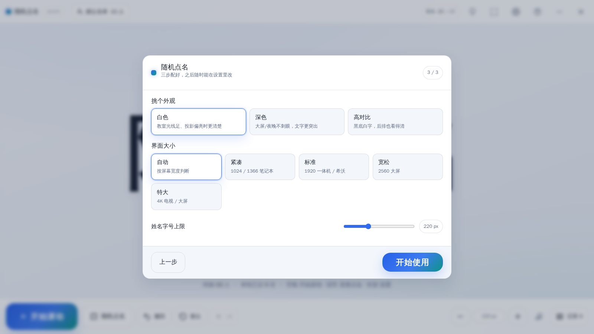
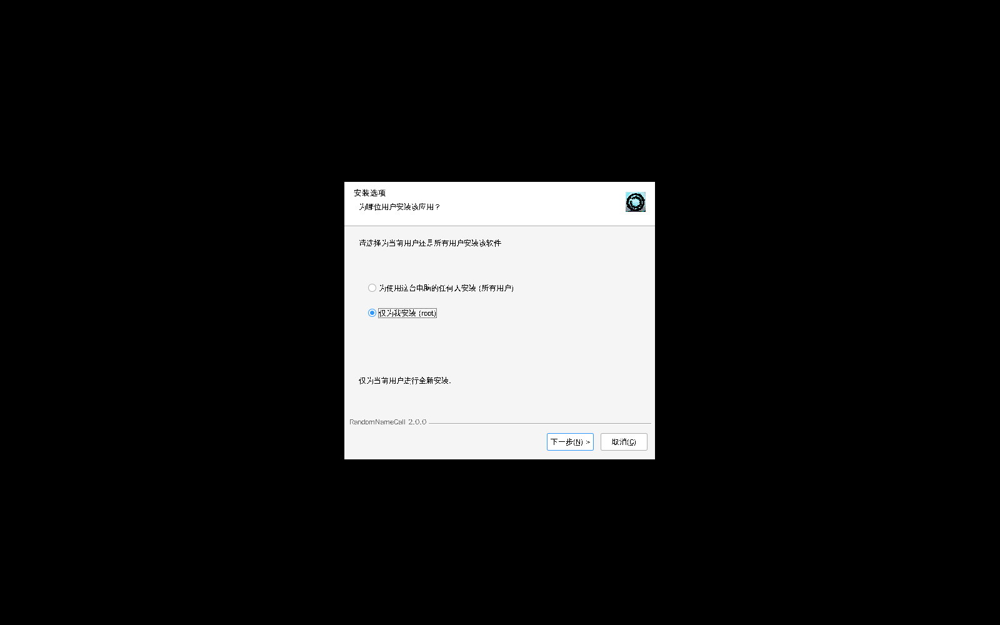

# 随机点名 · RandomNameCall

> 课堂教学用的**随机点名 + 滚动抽签**桌面应用。大屏、希沃一体机、单屏触摸都没问题，断网也能用。


-47848f)


Electron + Vue 3 + TypeScript 重写版。原版是 Python + tkinter 单文件程序（思路来自 B 站 @xxk，Rb9-1376 后续维护），本版按"大屏 / 单屏 / 触摸优先"重新实现，旧版源码存档在 [`legacy/`](legacy/)。

---

## 下载安装

| 系统 | 安装包 | 运行时 |
|---|---|---|
| Windows 10/11 64 位 | [`RandomNameCall-Setup-0.2.0.0-x64.exe`](https://github.com/Rb9-1376/RandomNameCall/releases/latest) | Electron 45.4.1 |
| Windows 10/11 32 位 | [`RandomNameCall-Setup-0.2.0.0-x86.exe`](https://github.com/Rb9-1376/RandomNameCall/releases/latest) | Electron 43.3.0 (ia32) |

- **按用户安装**，装到 `%LOCALAPPDATA%\Programs\RandomNameCall`，不弹管理员权限；
- 安装向导：欢迎 → 许可协议 → 组件（完整/精简）→ 安装位置 → 预检查（系统版本/位数/已装版本）→ 部署 → 完成（可立即运行）；
- 静默安装：`RandomNameCall-Setup-0.2.0.0-x64.exe /VERYSILENT /SUPPRESSMSGBOXES /LOG="%TEMP%\rnc.log"`；
- 完整性校验：`SHA256SUMS.txt` 随 Release 提供，`Get-FileHash <安装包> -Algorithm SHA256` 对照；
- 卸载：控制面板 / 开始菜单卸载项，会清理缓存与日志，**询问是否保留名单与设置**（默认保留）。

> 安装包未做代码签名，首次运行可能出现 SmartScreen「未知发布者」提示，属信誉提示，不影响使用。

## 界面

| 主界面（1600×900） | 设置抽屉 |
|---|---|
|  |  |

| 4K 大屏（3840×2160） | 悬浮球 |
|---|---|
|  |  |

| 首次启动向导 | 安装向导 |
|---|---|
|  |  |

## 功能

**点名**

- **随机点名**：直接出结果，可开抽取动画
- **滚动点名**：空格开始滚动，再按空格定格（间隔 60ms 渐缓到 260ms）
- **不重复点名**：抽过进"已抽"池，剩余 `x/y` 实时显示，抽满自动开新一轮
- **撤回**：回池 + 累计 −1 + 记录标记作废，`Ctrl+Z`
- **+1 权重**：给当前姓名加权（显示"张三 · ×3"），权重越高越容易被抽到；本场有效
- **累计次数**：按姓名累计，可一键清零
- **记录**：每次点名落盘，可导出 CSV（带 BOM，Excel 直接打开不乱码）
- **语音播报**：系统 TTS 念名字，默认关闭
- **名单体检**：统计空行、重复、偏长、疑似异常，可一键整理

**界面**

- 大字姓名 + 自动缩字：12 字长姓名不溢出，字号按屏高自动收敛
- 三色可调（背景/按钮/姓名）+ 整体透明度（下限 35%）
- 主题：白色（默认）/ 深色 / 高对比；系统字体下拉，不联网
- 界面缩放 0.8–1.6 + 四档密度，1K/2K/4K 通用
- 窗口模式（原生标题栏）/ 全屏 kiosk（F11 / Esc）、置顶、最小化到悬浮球
- **低配模式**：一键关闭毛玻璃与动效，老电脑也流畅
- **13 种语言**：中文、英、俄、韩、日、阿拉伯、西、印地、法、藏、维吾尔、蒙古（回鹘体）、彝；RTL 与竖排已适配，语言按需加载不占首屏

**悬浮球**

- 常驻桌面，左右自动吸附、半收起；拖动移动，轻触展开四向菜单（点名/滚动/设置/收起）
- 抽签时阻止息屏

**多班级与名单**

- 多班级切换、在线名单（JSON/纯文本，带本地缓存与线路测速）
- 名单文件改完自动热重载，不用手动重读

## 快捷键

| 按键 | 作用 |
|---|---|
| `空格` / `PageUp` / `PageDown` | 开始 / 暂停滚动 |
| `回车` | 直接抽一个 |
| `Esc` | 停止滚动 / 关闭弹窗或抽屉 / 退出全屏 |
| `F11` | 切换全屏 |
| `S` | 打开设置 |
| `H` | 打开帮助 |
| `Ctrl+Z` | 撤回上一次点名 |
| 舞台长按 600ms / 鼠标右键 | 打开设置（触摸屏无右键） |

## 名单文件怎么准备

支持 `.txt` / `.csv` / `.xlsx` / `.xls`：

- 一行一个姓名，也支持逗号、分号、Tab 分隔，取第一列；
- 自动去序号前缀（`1. 张三`、`1、张三`、`01 张三` 都能识别）；
- 单条姓名上限 32 字；
- 编码 9 选项：自动 / UTF-8 / UTF-8-SIG / UTF-16 / UTF-16 LE / UTF-16 BE / GB18030 / GB2312 / BIG5（"自动"先看 BOM 再嗅探，置信度低回退 GB18030）；
- Excel 优先取列头含 `姓名|名字|学生|name` 的列；
- 文件保存后当前名单自动重载（去抖 400ms）。

## 数据存放与备份

默认 `%APPDATA%\RandomNameCall\data\`：

```
data/
  data.json            # 设置 + 班级 + 记录
  data.json.bak        # 上一份副本
  roster-cache.json    # 在线名单缓存
  logs/app.log         # 运行日志
  backups/data-YYYY-MM-DD.json   # 每日一份，保留 14 份
```

写入是**原子写**（`.tmp` → rename），断电不会写坏；`data.json` 损坏自动从 `.bak` 恢复，两者都坏则用默认值启动。设置 → "数据" 可打开目录或改位置（机房还原卡环境建议放非还原盘）。

## 开发

```bash
pnpm install        # 依赖：vue / iconv-lite / jschardet / xlsx
pnpm dev            # 开发（electron-vite 热更新）
pnpm typecheck      # vue-tsc 类型检查
pnpm build          # 构建到 out/
pnpm start          # 跑构建产物
```

## 打包

**标准安装包（双架构 · Inno Setup）**

```powershell
pnpm build
npx electron-builder --win --x64 --dir --config.directories.output=dist-x64
npx electron-builder --win --ia32 --dir --config.directories.output=dist-x86 --config.electronVersion=43.3.0
& "<Inno Setup 6>\ISCC.exe" /DArch=x64 installer\setup.iss
& "<Inno Setup 6>\ISCC.exe" /DArch=x86 installer\setup.iss
```

细节（总纲逐项、防误报策略、静默参数）见 [installer/INSTALLER.md](installer/INSTALLER.md)。

**快速通道（NSIS）**

```bash
pnpm dist:dir       # 只出目录：dist/win-unpacked/RandomNameCall.exe
pnpm dist           # NSIS 安装包：dist/RandomNameCall-<version>-x64.exe
```

## 目录结构

```
src/
  main/            主进程：单实例、窗口、IPC、本地数据、名单读写、在线名单、更新
  preload/         contextBridge 暴露 window.api / window.extra
  renderer/        Vue 3 界面：主界面、悬浮球、设置抽屉、多语言
  shared/          主/渲染共享类型
resources/         内置名单、图标、音效
installer/         双架构安装脚本（Inno）与产物
legacy/            旧版（Python + tkinter）源码与安装包存档
docs/              截图
out/               构建产物（不进仓库）
```

## 文档

- [维护与编译指南](MAINTENANCE.md)
- [从旧版迁移](MIGRATION.md)
- [安装程序说明（双架构 / 防误报 / 静默参数）](installer/INSTALLER.md)

## 致谢与协议

- 原版思路：B 站 @xxk；原版维护：Rb9-1376，协作：89rl / TYH / XKK
- 使用 MIT License，详见 [LICENSE.txt](LICENSE.txt)
